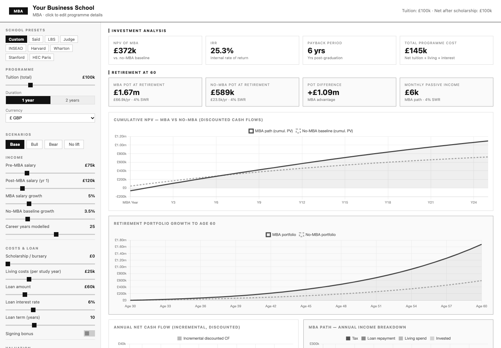
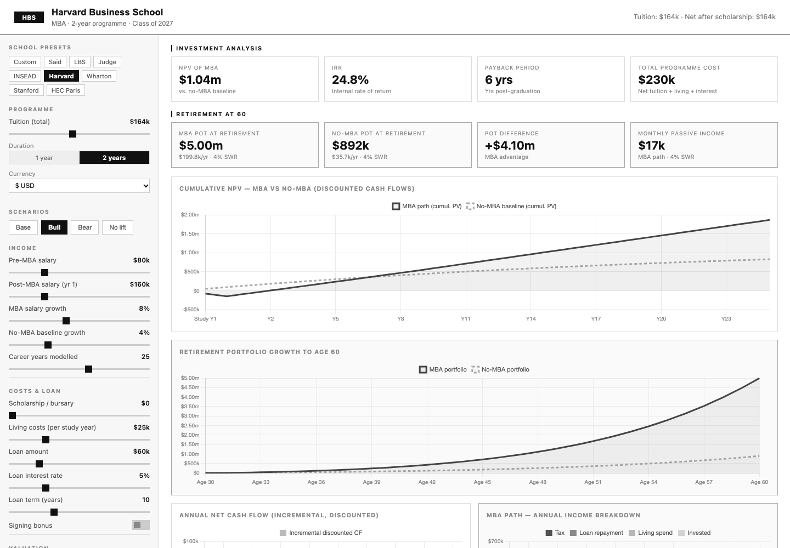
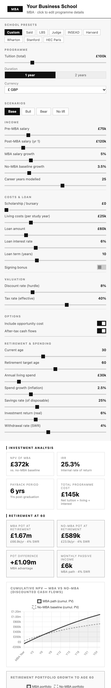

# MBA NPV Calculator

Is an MBA worth it? A single-page calculator that treats the degree as an
investment. It compares an MBA career path against staying put and shows:

- **NPV, IRR and payback period** of the incremental cash flows
- **Total programme cost**: net tuition, living costs and loan interest
- **Retirement impact**: projected portfolio at your target age on each path,
  and the monthly income it supports at a chosen withdrawal rate
- Charts for cumulative discounted cash flow, portfolio growth, annual income
  breakdown, loan amortisation and salary trajectory

| Harvard preset, Bull scenario | Mobile layout |
| --- | --- |
|  |  |

Comes with presets for several business schools (Saïd, LBS, Judge, Warwick, INSEAD, Harvard,
Wharton, Stanford, HEC Paris) and Base, Bull, Bear and No-lift scenarios. Every input
is a slider, and you can click the school name and badge in the header to edit them.

## What it's for

Deciding whether an MBA makes financial sense for you, before you commit to one:

- Compare schools on cost, programme length and currency
- Test how scholarships, loan size and rate, and post-MBA salary change the result
- See where the break-even point sits, and how sensitive it is to your assumptions
- Look past the first few years to the effect on your retirement savings

## Usage

Open `index.html` in a browser. There is no build step and no backend. The page
logic lives in `app.js`, and [Chart.js](https://www.chartjs.org/) loads from
jsDelivr with a Subresource Integrity hash. A Content-Security-Policy (set in a
`<meta>` tag) allows scripts only from `app.js` and that one Chart.js file, with
no inline scripts or event handlers, and blocks all network requests (`connect-src
'none'`). Inline styles are still allowed.

## Disclaimer

This is an illustrative model, not financial advice. The tuition figures in the
presets are approximate published fees and go out of date quickly, so check them
against each school's website.
